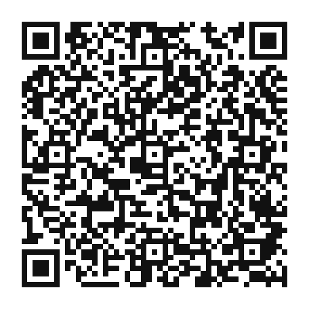

<!-- pf-windows-20261124:start -->
## Kebijakan privasi — Android dan Windows

**Tambahan Windows: 24 November 2026**

Kebijakan ini mencakup edisi Android dan Windows yang dikembangkan oleh Anselmo Eller. Bagian asli di bawah menjelaskan Android (Ketenangan Finansial); tambahan ini menjelaskan praktik khusus Windows (Kedamaian Finansial). Edisi Windows sedang dipersiapkan untuk Microsoft Store dan belum dirilis untuk umum. Informasi lisensi menjelaskan integrasi yang direncanakan dan akan ditinjau sebelum peluncuran.

### Data dan keamanan lokal

Windows dapat menyimpan pengeluaran, pemasukan, tugas, pengingat, catatan, jurnal, target tabungan, kuitansi, audio, teks hasil pengenalan, dan preferensi. Basis data terstruktur dienkripsi secara lokal dengan AES-256-GCM; kunci dilindungi penyimpanan aman Windows (Electron safeStorage/DPAPI). PIN akses opsional terdiri dari 8–16 angka. Tidak ada akun daring pengembang atau sinkronisasi catatan otomatis. Perlindungan bergantung pada perangkat dan tidak menghilangkan semua risiko. Biometrik Windows Hello belum tersedia.

### Mikrofon, dikte dan OCR

Mikrofon digunakan saat Anda meminta perekaman. Transkripsi bawaan mencoba memakai pengenal suara lokal Windows yang kompatibel dengan bahasa; ketersediaan bergantung pada izin, komponen terpasang dan format audio. Jika Anda menggunakan pengetikan suara Windows (Win + H), layanan suara Windows dapat memproses informasi secara daring sesuai pengaturan Anda. OCR menggunakan berkas yang Anda pilih dan alat lokal yang kompatibel. Rekaman tidak dikirim otomatis ke pengembang untuk ditranskripsi. Untuk transkripsi, aplikasi membuat berkas WAV sementara lokal dan mencoba menghapusnya setelah selesai. Kegagalan atau penghentian mendadak dapat menyisakan berkas sementara pada perangkat.

### Cadangan, berkas dan notifikasi

Cadangan portabel dienkripsi dan dilindungi kredensial yang diperlukan formatnya. Cadangan Windows dapat memakai PIN tersendiri sepanjang 8–16 angka. Cadangan otomatis Pro menggunakan folder pilihan dan memerlukan aplikasi berjalan serta penyimpanan aman tersedia; tidak ada cadangan awan dari pengembang. Simpan kredensial dengan aman. PDF, TXT dan berkas ekspor lainnya dapat berisi data pribadi dan tidak otomatis dilindungi PIN aplikasi. Notifikasi lokal bergantung pada izin Windows; judul dan tanggal dapat muncul di layar terkunci.

### Pembelian Pro dan layanan eksternal

Distribusi dan pembukaan fitur Pro melalui pembayaran satu kali di Microsoft Store sedang dipersiapkan. Setelah diterapkan, Microsoft akan memproses pembayaran dan validasi lisensi; aplikasi tidak seharusnya menerima rincian kartu lengkap. Microsoft dapat memproses data akun, transaksi, lisensi, perangkat dan koneksi sesuai kebijakannya. Pembelian Android dan Windows terpisah. Edisi Windows saat ini tidak memiliki iklan, AdMob, pengumuman Firebase atau telemetri jarak jauh pengembang. Permintaan kurs Frankfurter opsional menggunakan kode mata uang, bukan saldo atau catatan; penyedia dapat menerima data teknis koneksi. Tautan eksternal mengikuti kebijakan layanan masing-masing.

### Retensi, penghapusan dan hak

Data lokal disimpan hingga dihapus atau dikeluarkan dari perangkat. Anda dapat mengakses, memperbaiki dan menghapus catatan di aplikasi; cadangan dan ekspor perlu dihapus terpisah. Pengembang tidak dapat menghapus atau memulihkan basis data lokal Anda dari jarak jauh. Untuk pertanyaan privasi dan hak sesuai hukum yang berlaku, hubungi moneyproapp@gmail.com. Pertanyaan pembelian dan lisensi mungkin juga memerlukan dukungan Microsoft.

[Pernyataan privasi Microsoft](https://privacy.microsoft.com/privacystatement) · moneyproapp@gmail.com

---

**Android (Ketenangan Finansial) — tersedia di Google Play**
<!-- pf-windows-20261124:end -->

# Kebijakan Privasi — Ketenangan Finansial

**Terakhir diperbarui:** 15 November 2026  
**Kontak privasi:** moneyproapp@gmail.com  
**Cara Ketenangan Finansial menyimpan dan melindungi data di perangkat serta menggunakan layanan eksternal.**

## 1. Aplikasi, penanggung jawab, dan tujuan

Ketenangan Finansial (sebelumnya MyMoney) dikembangkan oleh Anselmo Eller dan tersedia di Google Play dengan ID paket Android com.anspro.mymoney.app. Aplikasi ini membantu mengelola pengeluaran, pemasukan, tagihan, tugas, catatan, rekaman, jurnal, dan target tabungan. Aplikasi tidak mengakses rekening bank, tidak mentransfer uang, dan tidak mewajibkan akun daring dari pengembang.

Data yang Anda masukkan digunakan untuk perhitungan, grafik, perkiraan, pengingat, dan pengelolaan pribadi. Isi catatan keuangan dan pribadi tidak dikirim ke pengembang atau digunakan untuk penargetan iklan.

## 2. Data dan penyimpanan lokal

Sesuai fitur yang digunakan, perangkat menyimpan nominal, tanggal, status pembayaran, keterangan, tugas, catatan, jurnal, rekaman, teks hasil pemindaian gambar, target tabungan, serta pengaturan bahasa, negara, mata uang, dan akses. Basis data terstruktur dienkripsi di perangkat dengan AES-256-GCM; kuncinya disimpan dalam penyimpanan aman sistem operasi.

PIN opsional sepanjang 8–16 digit dan biometrik pada perangkat yang mendukung dapat membatasi akses. Aplikasi tidak mengumpulkan templat biometrik. Rekaman audio disimpan di ruang privat aplikasi, tetapi tidak otomatis dienkripsi dengan cara yang sama seperti basis data terstruktur. Tidak ada perlindungan yang dapat menghilangkan seluruh risiko.

## 3. Izin, suara, gambar, dan notifikasi

Mikrofon, kamera, dan gambar yang dipilih digunakan ketika Anda merekam, mendikte, atau memindai teks. Pengenalan teks gambar (OCR) dilakukan secara lokal; gambar asli tidak otomatis disimpan dalam catatan dan berkas sementara dihapus jika memungkinkan. Transkripsi rekaman tersimpan, jika didukung, membutuhkan pengenalan suara di perangkat. Dikte langsung dapat menggunakan layanan suara sistem atau pihak ketiga yang, sesuai pengaturan perangkat, memproses audio melalui internet.

Dengan izin Anda, aplikasi menjadwalkan pengingat lokal untuk tagihan, pemasukan, tugas, dan catatan. Judul atau tanggal jatuh tempo mungkin terlihat pada layar terkunci. Izin dapat ditolak atau dicabut, tetapi fitur yang terkait mungkin tidak dapat digunakan.

Layar Izin dan persetujuan memberi penjelasan serta tindakan masing-masing untuk kamera, mikrofon, notifikasi, alarm tepat waktu, biometrik, pemilihan foto dan berkas, preferensi iklan, dan ketiga layanan Firebase. Tidak ada tombol “Izinkan semua”. Jika Android mengendalikan izin tersebut, aplikasi menampilkan permintaan sistem atau membuka pengaturan perangkat; pemilihan berkas atau folder hanya diminta saat diperlukan. Fitur tertentu mungkin tidak berfungsi tanpa izinnya, tetapi fitur keuangan utama tetap tersedia.

## 4. Pencadangan dan ekspor

Cadangan data portabel menggunakan AES-256-GCM dan scrypt. Cadangan manual dilindungi PIN. Pengguna Pro dapat mengaktifkan cadangan otomatis luring di folder lokal pilihannya dengan kunci pemulihan terpisah sepanjang 16 digit. Pengembang tidak menerima kunci tersebut dan tidak dapat memulihkan berkas tanpa kredensial yang benar.

Pencadangan dicoba saat aplikasi terbuka atau kembali ke layar depan; proses tidak dijamin saat aplikasi ditutup. Cadangan data tidak otomatis memuat rekaman audio, yang dapat diekspor dalam paket terenkripsi terpisah. Ekspor jurnal TXT atau rekaman yang dibagikan langsung mungkin tidak terenkripsi. Anda menentukan penyimpanan dan penghapusan berkas ekspor. Pengembang tidak menyediakan pencadangan atau sinkronisasi cloud otomatis.

## 5. Iklan dan persetujuan

Versi gratis dapat menampilkan iklan Google AdMob. SDK dapat memproses alamat IP, pengenal perangkat atau iklan, interaksi iklan, dan diagnostik untuk penayangan, pengukuran, keamanan, serta pencegahan penipuan. Permintaan iklan dikonfigurasi sebagai tidak dipersonalisasi, tetapi pemrosesan data teknis masih mungkin terjadi.

Google User Messaging Platform (UMP) mengelola pilihan privasi dan persetujuan jika diwajibkan oleh hukum; jika tersedia, pilihan dapat ditinjau kembali di Pengaturan. Tidak memberikan persetujuan yang diperlukan untuk iklan tidak memblokir fitur utama keuangan dan pribadi. Pengguna Pro dengan lisensi terverifikasi tidak melihat banner iklan.

### Firebase Analytics, Crashlytics, dan Performance Monitoring — opsional

Dalam aplikasi Android resmi, Ketenangan Finansial menyediakan tiga layanan Google Firebase yang terpisah: Analytics (statistik penggunaan), Crashlytics (diagnostik gangguan), dan Performance Monitoring (pengukuran kinerja). Pengguna dapat menyetujui atau menolak masing-masing secara terpisah melalui Pengaturan → Data dan privasi Anda → Izin dan persetujuan. Pengumpulan oleh ketiga layanan tersebut dinonaktifkan secara bawaan dan hanya seharusnya diaktifkan setelah persetujuan yang sesuai. Pada penggunaan pertama atau setelah pembaruan, pemberitahuan dapat mengajak pengguna meninjau pilihan; membuka halaman tersebut atau memilih “Nanti” bukan persetujuan. Pilihan ini terpisah dari preferensi iklan AdMob.

Jika Analytics diizinkan, Google dapat menerima peristiwa penggunaan, seperti pembukaan pertama, sesi, dan layar yang dikunjungi, versi aplikasi, model dan sistem perangkat, pengenal instans aplikasi, serta bergantung pada SDK dan pengaturannya, pengenal iklan dan perkiraan lokasi berdasarkan alamat IP. Data tersebut dipakai untuk memahami penggunaan dan meningkatkan aplikasi. Jumlah uang, deskripsi rekening, isi catatan, dan data yang dimasukkan pengguna tidak dimasukkan secara sengaja ke data analitik.

Jika Crashlytics diizinkan, Google dapat menerima laporan aplikasi berhenti, kesalahan nonfatal, jejak tumpukan teknis, pengenal instalasi, serta informasi aplikasi, sistem operasi, dan perangkat untuk menyelidiki masalah kestabilan. Diagnostik khusus dibatasi pada kode teknis yang telah ditentukan. PIN, saldo, teks catatan, rekaman audio, atau isi dokumen tidak ditambahkan secara sengaja ke laporan.

Jika Performance Monitoring diizinkan, Google dapat menerima durasi pembukaan aplikasi, tampilan layar, dan operasi yang dipantau, metrik kinerja dan jaringan (misalnya waktu permintaan dan alamat layanan tanpa parameter URL atau isi permintaan), serta detail teknis perangkat, versi aplikasi, pengenal instalasi, dan perkiraan lokasi. Pengukuran khusus menggunakan nama teknis tetap tanpa isi keuangan atau pribadi.

Penolakan atau pencabutan persetujuan tidak menghalangi fitur keuangan, catatan, tugas, cadangan lokal, atau akses Pro. Pencabutan menghentikan pengumpulan berikutnya oleh layanan terkait, tetapi tidak otomatis menghapus data yang sudah diterima Google. Komponen infrastruktur Firebase, termasuk Firebase Installations, dapat menggunakan pengenal instalasi teknis untuk beroperasi; mematikan peristiwa tidak selalu menghentikan semua pemrosesan teknis SDK. Google dapat memproses data menurut ketentuan penyimpanan dan transfer internasionalnya. Lihat kebijakan privasi Google dan dokumentasi privasi Firebase; untuk data di bawah kendali pengembang, gunakan kontak pada halaman ini.

Documentação do Firebase: https://firebase.google.com/support/privacy  
Política de Privacidade do Google: https://policies.google.com/privacy

## 6. Pembelian Pro dan layanan eksternal

Pembayaran Pro diproses oleh Google Play; aplikasi tidak menerima rincian kartu lengkap. Untuk memverifikasi atau memulihkan lisensi, aplikasi mengirim ID produk, token pembelian, ID permintaan, dan token sementara Play Integrity melalui HTTPS ke layanan verifikasi Google Cloud. PIN, catatan keuangan, catatan pribadi, dan audio tidak dikirim.

Permintaan kurs kepada API Frankfurter hanya berisi kode mata uang, bukan saldo. Google, Frankfurter, GitHub Pages sebagai penyedia hosting halaman ini, serta situs yang Anda kunjungi secara sukarela dapat memproses data teknis koneksi seperti alamat IP sesuai kebijakan masing-masing.

## 7. Penyimpanan, penghapusan, dan transfer data

Data lokal tetap berada di perangkat hingga Anda menghapusnya, membersihkan data aplikasi, atau mencopotnya. Fitur pembersihan memungkinkan pemilihan profil dan kategori. Salinan ekspor atau berkas yang dibagikan harus dihapus secara terpisah. Pengembang tidak dapat membaca, menghapus, atau memulihkan basis data terenkripsi di perangkat dari jarak jauh.

Penyedia eksternal dapat menyimpan log teknis untuk operasional, keamanan, pencegahan penipuan, atau kewajiban hukum sesuai masa simpan masing-masing. Layanan tersebut dapat memproses data teknis lintas negara dengan perlindungan yang berlaku; masa simpan pihak ketiga tidak berada di bawah kendali kami.

## 8. Dasar pemrosesan dan hak pengguna

Pemrosesan lokal diperlukan untuk menyediakan fitur yang Anda pilih. Jika relevan, verifikasi pembelian dan pencegahan penipuan berkaitan dengan penyediaan layanan serta kepentingan sah di bidang keamanan. Penggunaan iklan yang memerlukan persetujuan mengikuti pilihan Anda dan hukum setempat. Kewajiban hukum juga dapat berlaku.

Sesuai peraturan yang berlaku, termasuk hukum perlindungan data di Indonesia dan LGPD Brasil jika relevan, Anda dapat meminta informasi, akses, perbaikan, penghapusan, atau menjalankan hak lainnya, termasuk menarik persetujuan jika berlaku. Untuk data yang dikendalikan pengembang, hubungi moneyproapp@gmail.com. Data yang hanya ada di perangkat dikelola melalui aplikasi; untuk data pihak ketiga, hubungi penyedianya.

## 9. Anak-anak dan perubahan

Aplikasi ini tidak secara khusus ditujukan untuk anak-anak. Gunakan sesuai klasifikasi usia Google Play dan pendampingan orang tua bila perlu.

Kebijakan akan diperbarui jika fitur, penyedia, atau kewajiban hukum berubah. Tanggal di atas menunjukkan versi yang berlaku.

---

<!-- FCM-20261120: atualização pública da política 1.3.0 -->
## Pengumuman resmi opsional — Firebase Cloud Messaging

Pada versi Android yang mendukung, Ketenangan Finansial dapat mengirim pengumuman umum tentang pembaruan, pemeliharaan, dan fitur baru melalui Firebase Cloud Messaging (FCM) dari Google. Fitur ini dinonaktifkan secara bawaan dan hanya diaktifkan setelah Anda memilih untuk menerimanya di Pusat Notifikasi serta memberikan izin Android yang diperlukan.

Dengan persetujuan Anda, Firebase dapat memproses token pendaftaran teknis dan pengenal instalasi, topik yang sesuai dengan bahasa pilihan di aplikasi, alamat IP, serta data teknis perangkat dan pengiriman. Data tersebut digunakan untuk menyalurkan pesan. Saldo, pengeluaran, PIN, isi catatan, rekaman, dan berkas cadangan tidak disertakan dalam pesan FCM. Pengembang tidak menyimpan basis data token pengguna sendiri.

Bahasa pesan mengikuti bahasa yang dipilih di aplikasi, yang dapat berbeda dari bahasa Android. Saat bahasa berubah, aplikasi mencoba berhenti berlangganan topik lama sebelum bergabung dengan topik baru. Saat offline, perubahan dan pembatalan mungkin tertunda hingga koneksi kembali. Pengiriman tidak dijamin; notifikasi dapat muncul pada layar kunci sesuai pengaturan perangkat.

Anda dapat menonaktifkan pengumuman kapan saja melalui Pusat Notifikasi. Pilihan ini terpisah dari pengingat lokal, izin Analytics, Crashlytics, Performance Monitoring, dan pengaturan iklan. Google memproses informasi teknis menurut kebijakan privasinya. Tidak diperlukan pembelian Pro.

## Versi 1.3.0: cadangan v4

Pada versi 1.3.0, cadangan data portabel terbaru memakai format v4 yang terenkripsi dan dapat dipulihkan menggunakan PIN asli atau kode pemulihan yang kompatibel, sesuai berkas. Cadangan lama mungkin tetap membutuhkan kredensial awal; mengganti PIN tidak mengubah berkas lama. Cadangan otomatis Pro tetap offline dalam folder pilihan dengan kunci pemulihan terpisah. Audio mungkin memerlukan arsip terenkripsi terpisah. Tidak ada sinkronisasi data keuangan ke server pengembang.

Fitur saat ini: pengeluaran, pemasukan, prakiraan, grafik dan laporan PDF, tagihan berulang, cicilan, tugas, catatan suara, OCR lokal, PIN 8–16 digit, biometrik, cadangan lokal terenkripsi, dan pilihan tema. Pengumuman resmi bersifat opsional dan memerlukan versi aplikasi yang kompatibel.

## Unduh Ketenangan Finansial di Google Play

Halaman resmi aplikasi Android. Instalasi dilakukan melalui Google Play. [Google Play](https://play.google.com/store/apps/details?id=com.anspro.mymoney.app&hl=id_ID).

