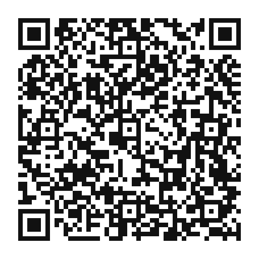

<!-- pf-windows-20261124:start -->
## Política de privacidade — Android e Windows

**Complemento Windows: 24 de novembro de 2026**

Esta política abrange as versões Android e Windows do aplicativo, desenvolvido por Anselmo Eller. As seções originais abaixo descrevem o Android; as regras específicas do Windows estão neste complemento. A versão Windows está em preparação para a Microsoft Store e ainda não foi lançada publicamente. As informações de licenciamento descrevem a integração planejada, sujeita à revisão antes do lançamento.

### Dados e segurança local

O Windows permite registrar despesas, rendas, tarefas, lembretes, notas, diário, metas de poupança, recibos, áudio, texto reconhecido e preferências. Os bancos estruturados são armazenados localmente com AES-256-GCM; a chave é protegida pelo armazenamento seguro do Windows (Electron safeStorage/DPAPI). O PIN de acesso é opcional, de 8 a 16 dígitos. Não há conta online do desenvolvedor nem sincronização automática de registros. A proteção depende do dispositivo e não elimina todos os riscos. A biometria Windows Hello ainda não está disponível.

### Microfone, ditado e OCR

O microfone é usado somente quando você solicita a gravação. A transcrição interna tenta usar um reconhecedor local do Windows compatível com o idioma; sua disponibilidade depende das permissões, componentes instalados e formato de áudio. Se você utilizar o ditado do sistema (Win + H), o serviço de voz do Windows poderá processar informações online conforme suas configurações. O OCR usa arquivos escolhidos por você e recursos locais compatíveis. Não há envio automático de gravações ao desenvolvedor para transcrição. Para transcrever, o aplicativo cria um arquivo WAV temporário local e tenta removê-lo ao terminar. Uma falha ou interrupção abrupta pode deixar arquivos temporários no dispositivo.

### Backups, arquivos e notificações

As cópias portáteis são criptografadas e protegidas pela credencial exigida pelo formato. Backups Windows podem utilizar um PIN próprio de 8 a 16 dígitos, independente do PIN de acesso. As cópias automáticas Pro usam a pasta escolhida e exigem que o programa esteja em execução e o cofre disponível; não há backup online do desenvolvedor. Mantenha a credencial em segurança. PDFs, TXT e outros arquivos exportados podem conter dados pessoais e não são automaticamente protegidos pelo PIN do app. As notificações locais dependem das permissões do Windows; títulos e datas podem ficar visíveis na tela bloqueada.

### Compras Pro e serviços externos

A distribuição e o desbloqueio Pro por compra única estão sendo preparados para a Microsoft Store. Quando implementado, o pagamento e a validação de licença serão processados pela Microsoft; o aplicativo não deverá receber os dados completos do cartão. A Microsoft poderá tratar dados de conta, transação, licença, dispositivo e conexão segundo suas políticas. Compras Android e Windows são independentes. A versão Windows atual não inclui publicidade, AdMob, comunicados Firebase nem telemetria remota do desenvolvedor. Consultas opcionais de câmbio à API Frankfurter usam códigos de moedas, não saldos ou notas; o provedor pode receber dados técnicos de conexão. Links externos seguem as políticas dos respectivos serviços.

### Retenção, exclusão e direitos

Os dados locais são mantidos até serem excluídos ou removidos do dispositivo. Você pode consultar, corrigir e limpar registros no aplicativo; backups e exportações devem ser removidos separadamente. O desenvolvedor não pode apagar ou recuperar remotamente seu banco local. Para dúvidas e direitos de privacidade conforme a legislação aplicável, inclusive LGPD, entre em contato com moneyproapp@gmail.com. Solicitações de compra e licença também podem exigir atendimento da Microsoft.

[Política de privacidade da Microsoft](https://privacy.microsoft.com/privacystatement) · moneyproapp@gmail.com

---

**Android — disponível na Google Play**
<!-- pf-windows-20261124:end -->

# Política de Privacidade — Paz Financeira

**Última atualização:** 15 de novembro de 2026  
**Contato para privacidade:** moneyproapp@gmail.com  
**Como o Paz Financeira armazena seus registros, protege os dados e utiliza serviços externos.**

## 1. Aplicativo, responsável e finalidade

O Paz Financeira (anteriormente MyMoney), desenvolvido por Anselmo Eller, identifica-se na Google Play pelo pacote Android com.anspro.mymoney.app. Organiza despesas, rendas, contas, tarefas, notas, áudios, diário e poupança. Não acessa contas bancárias nem movimenta dinheiro. Não é necessário criar uma conta online com o desenvolvedor.

O aplicativo usa os registros que você insere para cálculos, gráficos, previsões, lembretes e organização pessoal. O conteúdo financeiro e pessoal não é enviado ao desenvolvedor nem usado para segmentar anúncios.

## 2. Informações e armazenamento local

Conforme as funções utilizadas, ficam no aparelho valores, datas, estados de pagamento, descrições, tarefas, anotações, registros do diário, gravações, textos reconhecidos de imagens, metas de poupança e preferências de idioma, país, moeda e acesso. Os bancos estruturados são criptografados localmente com AES-256-GCM; as chaves ficam no armazenamento seguro do sistema operacional.

O PIN opcional de 8 a 16 dígitos e a biometria, quando disponível, protegem o acesso; o aplicativo não coleta modelos biométricos. Arquivos de áudio ficam na área privada do app, mas não são automaticamente criptografados como os bancos estruturados. Nenhuma proteção elimina todos os riscos, especialmente em aparelhos sem bloqueio ou comprometidos.

## 3. Permissões, voz, imagens e notificações

Microfone, câmera e seleção de imagens são acessados quando você usa gravação, ditado ou digitalização de texto. O reconhecimento de texto em imagens (OCR) ocorre localmente; a imagem original não é salva automaticamente na nota e os arquivos temporários são eliminados quando possível. A transcrição de gravações, quando compatível, exige reconhecimento no dispositivo. O ditado ao vivo pode utilizar serviços de voz do sistema ou de terceiros, que podem processar áudio pela rede conforme as configurações do aparelho.

As notificações de contas, rendas, tarefas e notas são agendadas localmente com sua autorização. Títulos e vencimentos poderão aparecer na tela bloqueada. As permissões podem ser recusadas ou revogadas, mas os recursos correspondentes podem deixar de funcionar.

A Central de Permissões e Consentimentos reúne explicações e ações individuais para câmera, microfone, notificações, alarmes exatos, biometria, seleção de fotos e arquivos, preferências de anúncios e os três serviços Firebase. Não existe autorização global “Permitir tudo”. Quando o Android controla a permissão, o aplicativo solicita a confirmação do sistema ou direciona às configurações do dispositivo; a escolha de arquivos ou pastas ocorre apenas quando necessária. Algumas funções específicas podem ficar indisponíveis sem sua permissão, mas o uso financeiro básico continua possível.

## 4. Backups e exportações

Backups de dados portáteis usam AES-256-GCM e scrypt. Backups manuais são protegidos por PIN. No Pro, o backup automático offline salva em uma pasta local escolhida por você e utiliza uma chave independente de recuperação de 16 dígitos. O desenvolvedor não recebe essa chave e não pode recuperar arquivos sem a credencial correta.

O backup automático é tentado com o aplicativo aberto ou quando ele volta ao primeiro plano, sem garantia de execução com o app fechado. Áudios não integram automaticamente o backup de dados; podem ser exportados em pacotes criptografados separados. Exportações TXT do diário e áudios compartilhados diretamente podem não ter criptografia. Você escolhe onde guardar e excluir esses arquivos. O desenvolvedor não oferece sincronização ou backup automático em nuvem.

## 5. Publicidade e consentimento

A versão gratuita pode exibir anúncios do Google AdMob. O SDK pode tratar endereço IP, identificadores do aparelho ou publicidade, interações com anúncios e diagnósticos para veiculação, medição, segurança e prevenção de fraude. Os anúncios são solicitados como não personalizados; isso não impede todo processamento técnico.

A Google User Messaging Platform (UMP) gerencia escolhas de privacidade e consentimento quando exigidos e, quando aplicável, permite revisá-los nas Configurações. A falta de consentimento necessário à publicidade não bloqueia as funções pessoais e financeiras. Usuários Pro com licença confirmada não veem banners.

### Firebase Analytics, Crashlytics e Performance Monitoring — opcionais

Na versão oficial do aplicativo para Android, o Paz Financeira disponibiliza três serviços distintos do Google Firebase: Analytics (estatísticas de utilização), Crashlytics (diagnóstico de falhas) e Performance Monitoring (análise de desempenho). Cada coleta pode ser autorizada ou recusada separadamente em Configurações → Seus dados e privacidade → Permissões e consentimentos. A coleta desses três serviços é configurada como desativada por padrão e só deve ser habilitada após a escolha correspondente. No primeiro uso ou após atualização, um aviso pode convidar à revisão; abrir a central ou escolher “Agora não” não representa consentimento. Essas escolhas são independentes das preferências de anúncios do AdMob.

Com o Analytics autorizado, o Google pode receber eventos de uso do aplicativo, como primeira abertura, sessões, telas acessadas, versão do app, modelo e sistema do dispositivo, identificador da instância do aplicativo e, conforme o SDK e as configurações, identificadores de publicidade e localização aproximada inferida do endereço IP. Esses registros servem para medir utilização e melhorar a experiência; não incluem intencionalmente valores financeiros, nomes de contas, notas ou outros conteúdos digitados.

Com o Crashlytics autorizado, o Google pode receber relatórios de travamento e de erros não fatais, rastros técnicos de execução (stack traces), identificadores da instalação e informações sobre aplicativo, sistema e dispositivo, para investigar problemas de estabilidade. Os diagnósticos personalizados são limitados a códigos técnicos previamente definidos; o aplicativo não adiciona intencionalmente PINs, saldos, textos, áudios ou conteúdo de documentos aos relatórios.

Com o Performance Monitoring autorizado, o Google pode receber tempos de inicialização, renderização e operações monitoradas, métricas de desempenho e de rede (por exemplo, duração da requisição e endereço do serviço, sem parâmetros de URL ou conteúdo da requisição), além de dados técnicos do aparelho, versão do app, identificadores de instalação e localização aproximada. As medições personalizadas usam nomes técnicos fixos, sem conteúdo financeiro ou pessoal.

Recusar ou revogar qualquer uma dessas autorizações não impede as funções financeiras, anotações, tarefas, backups locais ou acesso Pro. A revogação interrompe a coleta futura do serviço correspondente, mas não apaga automaticamente informações já recebidas pelo Google. Componentes de infraestrutura do Firebase, como Firebase Installations, podem utilizar identificadores técnicos para operar; desativar eventos de Analytics, Crashlytics ou Performance não equivale necessariamente a impedir todo processamento técnico dos SDKs. O Google pode tratar dados conforme seus próprios prazos e regras, inclusive internacionalmente. Informações sobre tratamento, retenção e direitos estão na Política de Privacidade do Google e na documentação de privacidade do Firebase; para solicitações ao desenvolvedor, use o contato indicado nesta página.

Documentação do Firebase: https://firebase.google.com/support/privacy  
Política de Privacidade do Google: https://policies.google.com/privacy

## 6. Compras Pro e serviços externos

As compras Pro são processadas pela Google Play, sem que o aplicativo receba dados completos do cartão. Para verificar ou restaurar licenças, o app envia por HTTPS ao verificador em Google Cloud o identificador do produto, token da compra, identificador de solicitação e token temporário Play Integrity. Esse processo não transmite PIN, registros financeiros, notas ou áudios.

As consultas de câmbio usam a API Frankfurter e enviam apenas códigos de moedas, nunca seus saldos. Google, Frankfurter, o GitHub Pages (que hospeda esta página) e os sites acessados voluntariamente podem tratar dados técnicos de conexão, como IP, conforme suas próprias políticas.

## 7. Retenção, exclusão e transferências

Os dados locais permanecem até você excluí-los, limpar o armazenamento ou desinstalar o app. A limpeza no aplicativo permite selecionar perfis e categorias. Cópias exportadas ou compartilhadas devem ser apagadas separadamente. O desenvolvedor não consegue ler, excluir ou recuperar remotamente os bancos locais criptografados.

Fornecedores externos podem manter registros técnicos para operação, segurança, prevenção de fraude ou exigências legais, conforme seus prazos. Esses serviços podem processar dados técnicos internacionalmente sob as garantias aplicáveis; não controlamos os períodos de conservação estabelecidos independentemente por terceiros.

## 8. Fundamentos legais e direitos

O tratamento local atende às funcionalidades solicitadas. Quando aplicável, a verificação de compras se relaciona à prestação do serviço e a interesses legítimos de segurança; tratamentos publicitários sujeitos a consentimento dependem das suas escolhas e da lei regional. Obrigações legais também podem justificar determinados registros técnicos.

Conforme a legislação aplicável, inclusive LGPD e RGPD, você pode solicitar acesso, informações, correção, exclusão, portabilidade, oposição ou revogação do consentimento quando cabíveis. Para dados sob controle do desenvolvedor, contate moneyproapp@gmail.com. Registros que permanecem somente no aparelho são gerenciados por você. Para informações tratadas por terceiros, utilize também os canais desses serviços.

## 9. Crianças e atualizações

O aplicativo não é direcionado especificamente a crianças. Seu uso deve seguir a classificação etária exibida na Google Play e a orientação dos responsáveis, quando necessária.

A política será atualizada se mudarem funcionalidades, fornecedores ou exigências legais. A data acima identifica a revisão vigente.

---

<!-- FCM-20261120: atualização pública da política 1.3.0 -->
## Comunicados oficiais opcionais — Firebase Cloud Messaging

Nas versões Android compatíveis, o Paz Financeira oferece comunicados gerais sobre atualizações, manutenção e novidades por meio do Firebase Cloud Messaging (FCM), do Google. O recurso começa desativado e só é habilitado quando você escolhe recebê-lo na Central de Notificações e concede a permissão necessária ao Android.

Com sua autorização, o Firebase pode tratar um token técnico de registro e identificadores da instalação, o tópico associado ao idioma escolhido, endereço IP e dados técnicos de entrega e do dispositivo. Esses dados servem para encaminhar comunicados. O aplicativo não inclui saldos, despesas, PIN, conteúdo de notas, áudios ou backups nas mensagens enviadas ao FCM; o desenvolvedor não mantém um banco próprio de tokens dos usuários.

O idioma da mensagem acompanha o idioma escolhido no aplicativo, não necessariamente o idioma do Android. Ao mudar o idioma, o app tenta cancelar a inscrição no tópico anterior e criar a nova inscrição. Se o celular estiver sem internet, alterações e cancelamentos podem ficar pendentes até a conexão voltar. A entrega não é garantida e o conteúdo poderá ser mostrado na tela bloqueada, conforme as configurações do aparelho.

Você pode desativar os comunicados na Central de Notificações a qualquer momento. Essa escolha é independente dos lembretes locais de contas e tarefas e das autorizações opcionais de Analytics, Crashlytics, Performance Monitoring e anúncios. O Google processa dados técnicos conforme suas próprias políticas de privacidade. O recebimento não exige compra Pro.

## Backup v4 e funcionalidades 1.3.0

Na versão 1.3.0, os backups portáteis de dados mais recentes usam o formato v4, com proteção criptográfica e possibilidade de recuperação com o PIN original ou o código de recuperação compatível, conforme o arquivo. Backups legados continuam sujeitos às credenciais exigidas pelo formato com que foram criados: mudar o PIN não altera automaticamente um arquivo antigo. O backup automático Pro permanece local, em pasta escolhida pelo usuário, com sua chave de recuperação própria; arquivos de áudio podem exigir pacotes criptografados separados. Não há sincronização de registros financeiros com servidor do desenvolvedor.

Recursos atuais: controle financeiro, previsões, salário e renda, gráficos e relatórios PDF, contas recorrentes, parcelas, tarefas, anotações com voz e OCR local, PIN de 8 a 16 dígitos, biometria, backup local criptografado e opções de acessibilidade visual. Comunicados oficiais são voluntários e dependem da versão compatível do aplicativo.

## Baixe o Paz Financeira na Google Play

Página oficial do aplicativo para Android. A instalação é feita pela Google Play. [Google Play](https://play.google.com/store/apps/details?id=com.anspro.mymoney.app&hl=pt_BR).

