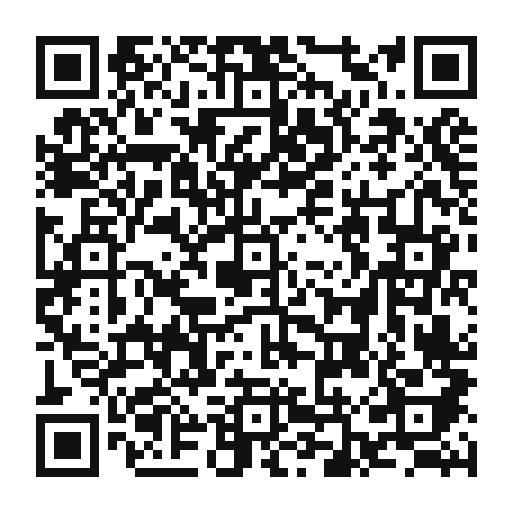

<!-- pf-windows-20261124:start -->
## Politique de confidentialité — Android et Windows

**Complément Windows : 24 novembre 2026**

Cette politique couvre les éditions Android et Windows développées par Anselmo Eller. Les sections d’origine ci-dessous décrivent Android ; ce complément précise les pratiques propres à Windows. L’édition Windows est en préparation pour le Microsoft Store et n’a pas encore été publiée. Les informations sur les licences décrivent l’intégration prévue, à vérifier avant le lancement.

### Données et sécurité locale

Windows permet de conserver dépenses, revenus, tâches, rappels, notes, journal, objectifs d’épargne, reçus, audio, texte reconnu et préférences. Les bases structurées sont chiffrées localement avec AES-256-GCM ; la clé est protégée par le stockage sécurisé de Windows (Electron safeStorage/DPAPI). Le code PIN d’accès facultatif comporte 8 à 16 chiffres. Il n’existe ni compte en ligne chez le développeur ni synchronisation automatique des données. La protection dépend de l’appareil et n’élimine pas tous les risques. La biométrie Windows Hello n’est pas encore disponible.

### Microphone, dictée et OCR

Le microphone est utilisé lorsque vous demandez un enregistrement. La transcription intégrée tente d’utiliser un moteur local Windows compatible avec la langue ; sa disponibilité dépend des autorisations, composants installés et formats audio. Si vous utilisez la saisie vocale Windows (Win + H), le service vocal de Windows peut traiter des informations en ligne selon vos réglages. L’OCR utilise les fichiers que vous choisissez et des outils locaux compatibles. Les enregistrements ne sont pas envoyés automatiquement au développeur pour transcription. Pour transcrire, l’application crée un fichier WAV temporaire local et tente de le supprimer à la fin. Une panne ou interruption brutale peut laisser des fichiers temporaires sur l’appareil.

### Sauvegardes, fichiers et notifications

Les sauvegardes portables sont chiffrées et protégées par les identifiants requis par leur format. Les sauvegardes Windows peuvent utiliser un PIN distinct de 8 à 16 chiffres. Les sauvegardes automatiques Pro utilisent le dossier choisi et nécessitent que l’application fonctionne et que le coffre soit accessible ; le développeur ne fournit pas de sauvegarde en ligne. Conservez les identifiants en lieu sûr. Les PDF, TXT et autres fichiers exportés peuvent contenir des données personnelles et ne sont pas automatiquement protégés par le PIN. Les notifications locales dépendent des autorisations Windows ; les titres et dates peuvent apparaître sur l’écran verrouillé.

### Achats Pro et services externes

La distribution et le déblocage Pro par achat unique via le Microsoft Store sont en préparation. Une fois intégrés, Microsoft traitera le paiement et la validation de licence ; l’application ne devrait pas recevoir les coordonnées complètes de carte. Microsoft peut traiter des données de compte, transaction, licence, appareil et connexion selon ses propres politiques. Les achats Android et Windows sont indépendants. L’édition Windows actuelle ne comporte ni publicité, ni AdMob, ni annonces Firebase, ni télémétrie distante du développeur. Les consultations facultatives de taux de change Frankfurter utilisent des codes de devises, non les soldes ou notes ; le fournisseur peut recevoir des données techniques de connexion. Les liens externes relèvent des politiques de chaque service.

### Conservation, suppression et droits

Les données locales sont conservées jusqu’à leur suppression ou leur retrait de l’appareil. Vous pouvez consulter, corriger et effacer vos données dans l’application ; les sauvegardes et exportations doivent être supprimées séparément. Le développeur ne peut ni effacer ni restaurer à distance votre base locale. Pour les questions de confidentialité et l’exercice de vos droits selon la loi applicable, contactez moneyproapp@gmail.com. Les demandes liées aux achats et licences peuvent également nécessiter l’assistance de Microsoft.

[Déclaration de confidentialité Microsoft](https://privacy.microsoft.com/privacystatement) · moneyproapp@gmail.com

---

**Android — disponible sur Google Play**
<!-- pf-windows-20261124:end -->

# Politique de confidentialité — Paix Financière

**Dernière mise à jour:** 15 novembre 2026  
**Contact confidentialité:** moneyproapp@gmail.com  
**Comment Paix Financière protège vos données sur l’appareil et utilise les services externes.**

## 1. Application, responsable et finalités

Paix Financière (anciennement MyMoney), développée par Anselmo Eller, est distribuée sur Google Play sous l’identifiant Android com.anspro.mymoney.app. Elle sert à gérer dépenses, revenus, factures, tâches, notes, enregistrements, journal et objectifs d’épargne. Elle n’accède pas aux comptes bancaires, ne transfère pas d’argent et ne nécessite pas de compte en ligne auprès du développeur.

Les informations saisies permettent calculs, graphiques, prévisions, rappels et organisation personnelle. L’application ne transmet pas le contenu de vos données financières ou privées au développeur et ne l’utilise pas pour cibler la publicité.

## 2. Données et stockage local

Selon les fonctions utilisées, l’appareil conserve montants, dates, états de paiement, descriptions, tâches, notes, journal, fichiers audio, textes reconnus dans les images, objectifs d’épargne et préférences de langue, pays, devise et accès. Les bases structurées sont chiffrées localement avec AES-256-GCM ; leurs clés sont conservées dans l’espace sécurisé du système d’exploitation.

Un code PIN facultatif de 8 à 16 chiffres et la biométrie sur les appareils compatibles peuvent limiter l’accès ; l’application ne recueille aucun modèle biométrique. Les enregistrements sont stockés dans l’espace privé de l’application mais ne bénéficient pas automatiquement du chiffrement des bases structurées. Aucune protection ne supprime tous les risques.

## 3. Autorisations, voix, images et notifications

Le microphone, l’appareil photo et les images choisies sont utilisés lorsque vous enregistrez, dictez ou numérisez du texte. La reconnaissance de texte (OCR) s’effectue sur l’appareil ; la photo d’origine n’est pas automatiquement enregistrée avec la note et les fichiers temporaires sont supprimés dans la mesure du possible. La transcription d’un enregistrement existant, lorsqu’elle est compatible, exige une reconnaissance locale. La dictée en direct peut employer les services vocaux du système ou de tiers, susceptibles de traiter l’audio via Internet selon les réglages.

Avec votre accord, des rappels locaux sont programmés pour les factures, revenus, tâches et notes. Titres et échéances peuvent s’afficher sur l’écran verrouillé. Vous pouvez refuser ou retirer les autorisations, mais certaines fonctions risquent de ne plus être disponibles.

Le panneau Autorisations et consentements explique et propose des actions individuelles pour la caméra, le microphone, les notifications, les alarmes exactes, la biométrie, la sélection de photos et fichiers, les préférences publicitaires et les trois services Firebase. Il n’existe aucun bouton « Tout autoriser ». Lorsque l’accès dépend d’Android, l’application présente sa demande système ou ouvre les paramètres de l’appareil ; la sélection de fichiers ou dossiers n’est demandée qu’au besoin. Certaines fonctions peuvent être indisponibles sans leur autorisation, mais les fonctions financières principales restent accessibles.

## 4. Sauvegardes et exportations

Les sauvegardes portables utilisent AES-256-GCM et scrypt. Les sauvegardes manuelles sont protégées par code PIN. Avec Pro, des sauvegardes automatiques hors ligne peuvent être réalisées dans un dossier local choisi, au moyen d’une clé de récupération indépendante de 16 chiffres. Le développeur ne reçoit pas cette clé et ne peut pas restaurer les fichiers sans les identifiants appropriés.

Les sauvegardes sont tentées lorsque l’application est ouverte ou revient au premier plan, sans garantie lorsqu’elle est fermée. Les données sauvegardées n’incluent pas automatiquement l’audio : des archives chiffrées séparées peuvent être exportées. Les exports TXT du journal et les audios partagés directement peuvent ne pas être chiffrés. Vous choisissez leur emplacement et leur suppression. Aucun service de sauvegarde ou synchronisation automatique dans le cloud n’est proposé par le développeur.

## 5. Publicité et consentement

La version gratuite peut afficher des publicités Google AdMob. Son SDK peut traiter les adresses IP, identifiants d’appareil ou publicitaires, interactions et données de diagnostic pour diffuser et mesurer les annonces, assurer la sécurité et prévenir la fraude. Les annonces sont demandées comme non personnalisées, mais un traitement technique reste possible.

Google User Messaging Platform (UMP) gère les choix de confidentialité et de consentement lorsque la loi l’exige et, le cas échéant, leur modification dans les Paramètres. L’absence d’un consentement nécessaire à la publicité ne bloque pas les fonctions personnelles et financières. Les utilisateurs Pro dont la licence est vérifiée ne voient pas de bannières.

### Firebase Analytics, Crashlytics et Performance Monitoring — facultatifs

Dans la version Android officielle, Paix Financière propose trois services distincts de Google Firebase : Analytics (statistiques d’utilisation), Crashlytics (diagnostic des incidents) et Performance Monitoring (mesures de performance). Chacun peut être autorisé ou refusé séparément dans Paramètres → Vos données et confidentialité → Autorisations et consentements. La collecte de ces trois services est désactivée par défaut et ne doit être activée qu’après le choix correspondant. Lors de la première utilisation ou après une mise à jour, un message peut inviter à examiner les options ; ouvrir cette page ou choisir « Plus tard » ne vaut pas consentement. Ces choix sont indépendants des préférences publicitaires AdMob.

Si Analytics est autorisé, Google peut recevoir des événements d’utilisation (premières ouvertures, sessions, écrans consultés), la version de l’application, le modèle et le système de l’appareil, un identifiant d’instance et, selon le SDK et ses paramètres, des identifiants publicitaires et une localisation approximative déduite de l’adresse IP. Ces données servent à comprendre l’utilisation et à améliorer l’expérience. Aucun montant financier, libellé de compte, texte de note ou autre contenu saisi n’est volontairement inclus.

Si Crashlytics est autorisé, Google peut recevoir des rapports de plantage et d’erreurs non fatales, des traces techniques d’exécution, des identifiants d’installation et des informations sur l’application, le système et l’appareil afin de résoudre les problèmes de stabilité. Les diagnostics personnalisés se limitent à des codes techniques prédéfinis. L’application n’y ajoute pas volontairement de PIN, soldes, textes, fichiers audio ou documents.

Si Performance Monitoring est autorisé, Google peut recevoir les durées de démarrage, d’affichage et d’opérations surveillées ainsi que des mesures de performance et de réseau (durée des requêtes et adresses des services, sans paramètres d’URL ni contenu des requêtes). Des informations techniques de l’appareil, la version, des identifiants d’installation et une localisation approximative peuvent aussi être traités. Les mesures personnalisées utilisent des noms techniques fixes, sans contenu financier ou personnel.

Refuser ou retirer une autorisation n’empêche pas d’utiliser les fonctions financières, les notes, les tâches, les sauvegardes locales ou Pro. Le retrait arrête la collecte future du service concerné, mais n’efface pas automatiquement les données déjà reçues par Google. Des composants d’infrastructure Firebase, notamment Firebase Installations, peuvent utiliser des identifiants techniques pour fonctionner ; désactiver les événements ne supprime donc pas nécessairement tout traitement technique des SDK. Google peut traiter ces données selon ses règles de conservation et de transfert international. Consultez les politiques de confidentialité de Google et de Firebase ; pour les données contrôlées par le développeur, utilisez le contact indiqué sur cette page.

Documentação do Firebase: https://firebase.google.com/support/privacy  
Política de Privacidade do Google: https://policies.google.com/privacy

## 6. Achats Pro et services externes

Les achats Pro sont traités par Google Play ; l’application ne reçoit pas l’intégralité des données de carte. Pour valider ou restaurer une licence, elle transmet par HTTPS au service de vérification hébergé sur Google Cloud l’identifiant du produit, le jeton d’achat, l’identifiant de requête et un jeton temporaire Play Integrity. Aucun code PIN, relevé financier, note ou audio n’est transmis.

Les demandes de taux de change adressées à l’API Frankfurter contiennent uniquement des codes de devises, jamais vos soldes. Google, Frankfurter, GitHub Pages (hébergeur de cette page) et les sites ouverts volontairement peuvent traiter des données techniques de connexion, comme l’adresse IP, selon leurs politiques.

## 7. Conservation, suppression et transferts

Les données locales restent jusqu’à leur suppression, l’effacement des données de l’application ou sa désinstallation. Le nettoyage permet de sélectionner catégories et profils. Les copies exportées ou partagées doivent être supprimées séparément. Le développeur ne peut pas consulter, supprimer ou restaurer à distance les bases locales chiffrées.

Les fournisseurs externes peuvent conserver des journaux techniques pour le fonctionnement, la sécurité, la lutte contre la fraude ou des obligations légales selon leurs propres durées. Ces services peuvent traiter des données techniques à l’international, avec les garanties applicables ; nous ne contrôlons pas leurs délais de conservation.

## 8. Fondements juridiques et droits

Le traitement local permet de fournir les fonctions demandées. Le cas échéant, la vérification des achats relève de la prestation du service et d’intérêts légitimes de sécurité ; les traitements publicitaires nécessitant un consentement dépendent de vos choix et des lois locales. Certaines obligations légales peuvent aussi s’appliquer.

Selon la réglementation applicable, notamment le RGPD et la LGPD brésilienne le cas échéant, vous pouvez demander l’accès, des informations, la rectification, l’effacement, la portabilité, l’opposition ou le retrait du consentement. Pour les données sous le contrôle du développeur : moneyproapp@gmail.com. Vous gérez vos données locales dans l’application ; pour celles de tiers, utilisez aussi leurs dispositifs.

## 9. Mineurs et modifications

L’application ne s’adresse pas spécifiquement aux enfants. Son utilisation doit respecter la classification d’âge de Google Play et, si nécessaire, l’accompagnement d’un responsable.

La politique sera révisée en cas de changement des fonctions, fournisseurs ou obligations légales. La date ci-dessus désigne la version en vigueur.

---

<!-- FCM-20261120: atualização pública da política 1.3.0 -->
## Communications officielles facultatives — Firebase Cloud Messaging

Dans les versions Android compatibles, Paix Financière peut envoyer des communications générales sur les mises à jour, la maintenance et les nouveautés via Firebase Cloud Messaging (FCM) de Google. Cette option est désactivée par défaut et nécessite une activation volontaire dans le Centre de notifications ainsi que l’autorisation Android appropriée.

Avec votre accord, Firebase peut traiter un jeton technique d’inscription et des identifiants d’installation, le sujet lié à la langue choisie dans l’application, l’adresse IP et des informations techniques de l’appareil et de livraison. Ces données servent à distribuer les messages. Aucun solde, dépense, PIN, contenu de note, enregistrement ou sauvegarde n’est inclus dans les messages FCM. Le développeur ne gère pas de base de données de jetons personnels.

Les messages suivent la langue choisie dans l’application, qui peut différer de la langue d’Android. En cas de changement, l’application tente d’abord de quitter l’ancien sujet puis de rejoindre le nouveau. Hors ligne, les changements et désinscriptions peuvent attendre le retour de la connexion. La livraison n’est pas garantie ; les messages peuvent apparaître sur l’écran verrouillé suivant les réglages du téléphone.

Vous pouvez désactiver les communications à tout moment dans le Centre de notifications. Cette option est distincte des rappels locaux, des autorisations Analytics, Crashlytics et Performance Monitoring et des préférences publicitaires. Google traite les données techniques selon ses politiques de confidentialité. Aucun achat Pro n’est requis.

## Version 1.3.0: sauvegardes v4

Avec la version 1.3.0, les sauvegardes portables récentes utilisent le format v4 chiffré et peuvent être restaurées avec le PIN d’origine ou un code de récupération compatible, selon le fichier. Les sauvegardes anciennes peuvent nécessiter leurs anciens identifiants : changer le PIN ne modifie pas les archives antérieures. Les sauvegardes automatiques Pro restent locales, dans un dossier choisi, avec une clé distincte. Les fichiers audio peuvent nécessiter des archives chiffrées séparées. Aucune synchronisation financière n’est réalisée sur un serveur du développeur.

Fonctions actuelles : dépenses, revenus et prévisions, graphiques et rapports PDF, paiements récurrents, échéances, tâches, notes vocales, OCR local, PIN de 8 à 16 chiffres, biométrie, sauvegardes locales chiffrées et thèmes. Les communications sont facultatives et nécessitent une version compatible.

## Télécharger Paix Financière sur Google Play

Fiche officielle de l’application Android. L’installation passe par Google Play. [Google Play](https://play.google.com/store/apps/details?id=com.anspro.mymoney.app&hl=fr_FR).

