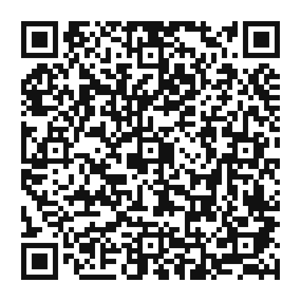

<!-- pf-windows-20261124:start -->
## Privacy policy — Android and Windows

**Windows supplement: November 24, 2026**

This policy covers the Android and Windows editions developed by Anselmo Eller. The original sections below describe Android; this supplement sets out the Windows-specific practices. The Windows edition is being prepared for the Microsoft Store and has not been publicly released. Licensing information describes the planned integration, subject to review before release.

### Data and local security

Windows can store expenses, income, tasks, reminders, notes, journals, savings goals, receipts, audio, recognized text and preferences. Structured databases are encrypted locally with AES-256-GCM; the key is protected by Windows secure storage (Electron safeStorage/DPAPI). The optional access PIN has 8–16 digits. There is no online developer account or automatic record synchronization. Protection depends on the device and cannot eliminate all risks. Windows Hello biometrics are not yet available.

### Microphone, dictation and OCR

The microphone is used when you request recording. Built-in transcription attempts to use a compatible local Windows speech recognizer; availability depends on permissions, installed components, language and audio format. If you use Windows voice typing (Win + H), the Windows speech service may process information online according to your settings. OCR uses files you select and compatible local tools. Recordings are not automatically sent to the developer for transcription. For transcription, the app creates a local temporary WAV file and attempts to remove it when finished. A failure or abrupt interruption may leave temporary files on the device.

### Backups, files and notifications

Portable backups are encrypted and protected by the credential required by their format. Windows backups may use a separate 8–16 digit backup PIN. Pro automatic backups use the selected folder and require the app to be running with its vault available; there is no developer cloud backup. Keep your credential safe. Exported PDFs, TXT and other files may contain personal data and are not automatically protected by the app PIN. Local notifications depend on Windows permissions; titles and dates may appear on the lock screen.

### Pro purchases and external services

Distribution and one-time Pro unlocking through the Microsoft Store are being prepared. Once implemented, Microsoft will process payment and license validation; the app should not receive complete card details. Microsoft may process account, transaction, license, device and connection data under its own policies. Android and Windows purchases are independent. The current Windows edition does not include ads, AdMob, Firebase announcements or developer remote telemetry. Optional Frankfurter exchange-rate queries use currency codes, not balances or notes; the provider may receive technical connection data. External links follow the relevant service policies.

### Retention, deletion and rights

Local data is retained until deleted or removed from the device. You can access, correct and clear records in the app; backups and exports must be removed separately. The developer cannot remotely delete or recover your local database. For privacy questions and rights under applicable law, contact moneyproapp@gmail.com. Purchase and licensing requests may also require Microsoft support.

[Microsoft Privacy Statement](https://privacy.microsoft.com/privacystatement) · moneyproapp@gmail.com

---

**Android — available on Google Play**
<!-- pf-windows-20261124:end -->

# Privacy Policy — Financial Peace

**Last updated:** November 15, 2026  
**Privacy contact:** moneyproapp@gmail.com  
**How Financial Peace keeps your records on your device, protects them and uses external services.**

## 1. App, developer and purpose

Financial Peace (formerly MyMoney), developed by Anselmo Eller, is distributed on Google Play as Android package com.anspro.mymoney.app. It helps manage expenses, income, bills, tasks, notes, audio, journal entries and savings goals. It does not access bank accounts or move money, and no developer-managed online account is required.

The records you enter are used for calculations, charts, forecasts, reminders and personal organization. The app does not upload the content of your financial or personal entries to the developer or use it for ad targeting.

## 2. Information and local storage

Depending on the features used, your device stores amounts, dates, payment status, descriptions, tasks, notes, journal entries, recordings, text recognized from images, savings goals and language, country, currency and access settings. Structured databases are encrypted locally using AES-256-GCM, with keys held in operating-system secure storage.

An optional 8–16-digit PIN and biometrics on supported devices can restrict access; the app does not collect biometric templates. Audio files are stored in the app's private area but are not automatically encrypted like the structured databases. No safeguard eliminates every risk, particularly on unsecured or compromised devices.

## 3. Permissions, voice, images and notifications

Microphone, camera and selected images are accessed when you choose to record, dictate or scan text. Image text recognition (OCR) runs on your device; the original image is not automatically saved with the note, and temporary files are removed where possible. Transcription of saved recordings, when supported, requires on-device recognition. Live dictation may use system or third-party speech services, which can process audio over a network depending on your device configuration.

With your permission, local reminders are scheduled for bills, income, tasks and notes. Titles or due dates may appear on the lock screen. You can deny or revoke permissions, although related features may then be unavailable.

The Permissions and consent screen explains and offers individual actions for camera, microphone, notifications, exact alarms, biometrics, photo and file selection, advertising preferences and the three Firebase services. There is no global “Allow all” option. Where Android controls access, the app displays the operating system’s permission request or takes you to device settings; selecting a file or folder is requested only when needed. Certain features may not work without their permission, but core financial features remain available.

## 4. Backups and exports

Portable data backups use AES-256-GCM and scrypt. Manual backups are PIN-protected. Pro users can enable offline automatic backups to a local folder of their choice, using a separate 16-digit recovery key. The developer does not receive that key and cannot recover files without the correct credential.

Automatic backups are attempted while the app is open or returns to the foreground; they are not guaranteed when the app is closed. Data backups do not automatically include audio, which can be exported in separate encrypted packages. Plain-text journal exports and directly shared audio may be unencrypted. You choose where exported files are stored and deleted. The developer does not offer cloud backup or automatic cloud sync.

## 5. Advertising and consent

The free version may display Google AdMob ads. Its SDK may process IP addresses, device or advertising identifiers, ad interactions and diagnostics to deliver and measure ads, support security and prevent fraud. Ad requests are configured as non-personalized, but technical processing can still occur.

Google User Messaging Platform (UMP) manages privacy and consent choices where legally required and, where applicable, allows you to review them in Settings. A lack of required advertising consent does not block core personal or financial features. Verified Pro users do not see banner ads.

### Firebase Analytics, Crashlytics and Performance Monitoring — optional

In the official Android app, Financial Peace offers three separate Google Firebase services: Analytics (usage statistics), Crashlytics (crash diagnostics), and Performance Monitoring (performance measurements). Each can be enabled or declined independently under Settings → Your data and privacy → Permissions and consent. Collection for these three services is configured as disabled by default and should be enabled only after the corresponding choice. On first use or after an update, an invitation may prompt users to review the options; opening the permissions screen or choosing “Not now” is not consent. These choices are independent of Google AdMob advertising preferences.

When Analytics is enabled, Google may receive app usage events, such as first launches, sessions and screens visited, app version, device model and operating system, an app-instance identifier and, depending on the SDK and settings, advertising identifiers and approximate location derived from IP address. This is used to understand app usage and improve the experience. Financial amounts, account descriptions, notes and other user-entered content are not intentionally included.

When Crashlytics is enabled, Google may receive crash and non-fatal error reports, technical stack traces, installation identifiers and app, operating-system and device details to investigate stability problems. Custom diagnostics use a fixed set of technical codes. The app does not intentionally attach PINs, balances, note text, audio or document contents to those reports.

When Performance Monitoring is enabled, Google may receive app startup, rendering and monitored-operation durations, performance and network metrics (such as request duration and service URLs, without URL parameters or request bodies), together with device details, app version, installation identifiers and approximate location. Custom measurements use fixed technical names, not financial or personal content.

Declining or withdrawing any of these choices does not prevent financial features, notes, tasks, local backups or Pro access. Withdrawal stops future collection by the corresponding service but does not automatically erase data already received by Google. Firebase infrastructure components, including Firebase Installations, may use technical installation identifiers to function; disabling Analytics, Crashlytics or Performance events does not necessarily stop all SDK-level technical processing. Google may process information under its own retention and international transfer practices. See Google’s Privacy Policy and Firebase privacy documentation for information about processing and rights; contact the developer using the address on this page for developer-controlled data.

Documentação do Firebase: https://firebase.google.com/support/privacy  
Política de Privacidade do Google: https://policies.google.com/privacy

## 6. Pro purchases and external services

Google Play handles Pro payments; the app does not receive full payment card details. To verify or restore purchases, the app sends a product identifier, purchase token, request identifier and temporary Play Integrity token over HTTPS to a Google Cloud verification service. This process does not transmit your PIN, financial entries, notes or audio.

Exchange-rate requests use the Frankfurter API and send only currency codes, never account balances. Google, Frankfurter, GitHub Pages (which hosts this notice), and sites you choose to open may process technical connection information such as IP addresses under their own policies.

## 7. Retention, deletion and international processing

Local records remain until you delete them, clear app data or uninstall the app. In-app cleanup lets you select profiles and categories. Exported or shared copies must be deleted separately. The developer cannot remotely read, delete or recover encrypted on-device databases.

External providers may retain technical logs for operations, security, fraud prevention or legal requirements under their own schedules. Such services may process technical information internationally under applicable safeguards; we do not control retention periods set independently by third parties.

## 8. Legal grounds and your rights

On-device processing supports the functions you request. Where applicable, purchase verification relates to providing the service and legitimate security interests; advertising processing requiring consent depends on your choices and regional laws. Legal obligations can also require some technical records.

Under applicable law, including the Brazilian LGPD and the EU/UK GDPR where relevant, you may have rights to information, access, correction, deletion, portability, objection and consent withdrawal. For information under the developer's control, contact moneyproapp@gmail.com. You manage device-only records yourself; for third-party information, use the respective providers' channels.

## 9. Children and changes

The app is not specifically directed at children. Its use should follow the Google Play age rating and appropriate parental guidance.

We will update this policy if features, providers or legal requirements change. The date above identifies the current revision.

---

<!-- FCM-20261120: atualização pública da política 1.3.0 -->
## Optional official announcements — Firebase Cloud Messaging

On supported Android app versions, Financial Peace can send general announcements about updates, maintenance and new features through Google Firebase Cloud Messaging (FCM). This feature is off by default and only starts after you opt in through the Notification Center and grant the relevant Android notification permission.

With your consent, Firebase may process a technical registration token and installation identifiers, the topic for your selected app language, an IP address and technical device and delivery data. These are used to route announcements. The app does not include financial balances, expenses, PINs, note contents, recordings or backup files in FCM messages. The developer does not operate a personal database of users’ FCM tokens.

Messages follow the language chosen inside the app, which may differ from your Android system language. If you change languages, the app attempts to leave the previous topic before joining the new one. While offline, changes and unsubscribe requests may remain pending until connectivity returns. Delivery is not guaranteed; notification content may appear on the lock screen depending on device settings.

You can opt out at any time in the Notification Center. This is separate from local bill and task reminders, optional Firebase Analytics, Crashlytics and Performance Monitoring settings, and advertising choices. Google processes technical information under its own privacy policies. A Pro purchase is not required.

## Version 1.3.0: v4 backup and current features

In version 1.3.0, newer portable data backups use format v4, with encryption and recovery using the original PIN or a compatible app recovery code, depending on the file. Older backups may still require their original credentials; changing your PIN does not rewrite earlier backup files. Pro automatic backups remain offline in a folder you choose, with a separate recovery key. Audio may require separate encrypted archives. Personal financial records are not synchronized with a developer-operated server.

Current features include expenses, forecasts, salary and income, charts and PDF reports, recurring bills, installments, tasks, voice notes and on-device OCR, an 8–16-digit PIN, biometrics, encrypted local backups and visual themes. Official announcements are optional and require a compatible app version.

## Get Financial Peace on Google Play

Official Android app listing. Installation is handled by Google Play. [Google Play](https://play.google.com/store/apps/details?id=com.anspro.mymoney.app&hl=en_US).

